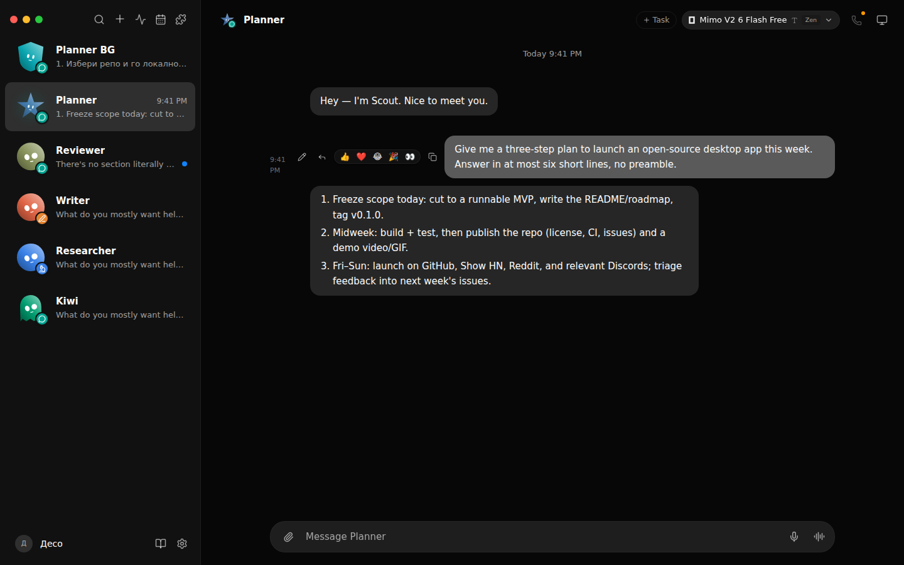
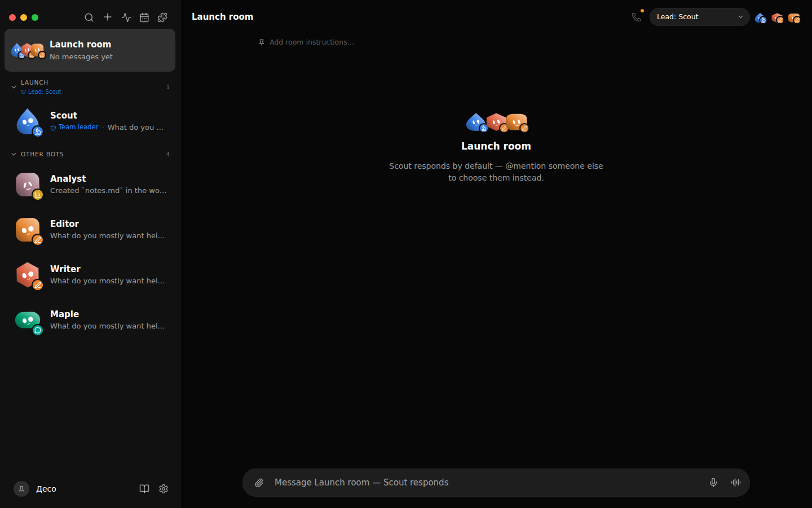
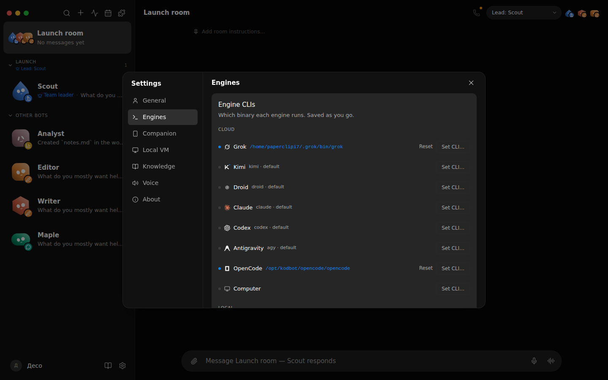

<div align="center">

# KodBot

**Claude Code, Codex and OpenCode in one window — a team of agents on your own machine, with your own logins.**

Every chat in the sidebar is a real agent process, not a prompt. It has its own model, its own thread,
its own computer, and its own connected apps. Talk to it like a contact. Watch it work. Approve what matters.



<a href="https://github.com/kod13eood-cmd/kodbot-releases/releases/latest/download/KodBot-setup.exe">
  
</a>
&nbsp;
<a href="https://github.com/kod13eood-cmd/kodbot-releases/releases/latest/download/KodBot.AppImage">
  
</a>
&nbsp;
<a href="https://github.com/kod13eood-cmd/kodbot-releases/releases/latest/download/KodBot-android.apk">
  
</a>

<sub>[Website](https://kodbot.kod13.com/) · [Docs](docs/) · [Discussions](https://github.com/kod13eood-cmd/KodBot/discussions) · [All releases](https://github.com/kod13eood-cmd/kodbot-releases/releases)</sub>

</div>

> **Early software (v0.1.x).** The loop works end to end — message → agent → streamed reply → tools → approval → computer use.
> Expect rough edges, especially on Linux and macOS. Windows and Linux builds are published; macOS has source support but no builds yet.

---

## Why this exists

Running one assistant in one box is the wrong shape for agents. You end up with three terminals, three
contexts, and no idea what any of them is doing.

KodBot keeps the shape that actually fits: **agents as contacts**. A roster of bots you can see at a glance,
each with its own model, memory, computer and apps — and every risky action stopped by an approval card
before it happens.

**What that means in practice**

- **Your agents, your logins.** Bots run the `claude`, `codex`, `grok` and `opencode` CLIs already installed
  on your machine. Your subscriptions, your keys, no new account, no proxy in the middle.
- **Local by default.** One small harness on `127.0.0.1` owns every agent process. Transcripts, keys and
  events live in `~/.kodbot` — not on someone's server.
- **Supervision, not autopilot.** Shell commands, file edits and questions arrive as cards: Allow, Deny, or
  answer. Nothing touches your machine without a click.
- **Hands, when you want them.** Any bot can get a real computer — a cloud Linux desktop it drives while you
  watch live — plus Gmail, Slack, GitHub, Notion and 500+ other apps through Composio.

## What you need

| | Requirement |
|---|---|
| **OS** | Windows 10/11 x64, Ubuntu 24.04 x64, or macOS (source only for now) |
| **An agent CLI** | At least one of [`claude`](https://claude.com/claude-code), [`codex`](https://github.com/openai/codex), [`grok`](https://x.ai/cli), [`opencode`](https://github.com/anomalyco/opencode) — installed and logged in |
| **Optional** | Composio key (apps), Box API key (cloud computers), ElevenLabs key (voice) |

The desktop app bundles its own harness, so you don't need Node, pnpm or a server to run a released build.
You do need at least one agent CLI — that's where the intelligence actually comes from.

## Get started in five minutes

1. **Install the app.** Windows: run the installer (per-user, no admin rights). Linux: `chmod +x` the
   AppImage (any distro), or the Debian/Ubuntu package — asset `KodBot-0.1.63-amd64.deb`, or the always-latest `KodBot.deb`; install with `sudo apt install ./KodBot*.deb`.
   The Windows installer isn't code-signed yet, so SmartScreen shows *"unknown publisher"* → **More info → Run anyway**.
2. **Make sure an agent CLI is installed and logged in.** If `claude` or `codex` already works in your
   terminal, you're done with this step.
3. **Open KodBot and send a message.** Bots pick up the engines they find automatically. Switch a bot's
   model from the picker at any time, mid-conversation.
4. **Optional:** add a Composio key in **App Settings** (gear in the sidebar footer) to give bots access to
   real apps, and a Box key if you want them to have their own computer.

Stuck? [Discussions → Q&A](https://github.com/kod13eood-cmd/KodBot/discussions/categories/q-a).
On Ubuntu, see the [Linux desktop guide](docs/linux-desktop.md) for capabilities and troubleshooting.

## What KodBot is not

- **Not a hosted service.** There's no account to create and no data leaving your machine unless you add a
  cloud computer or an app integration yourself.
- **Not a model.** It doesn't ship weights or resell tokens — it drives the CLIs you already pay for.
- **Not a replacement for the CLIs.** It's the cockpit around them: roster, threads, approvals, apps,
  screens. If you love your terminal, keep it; KodBot is for when three terminals stop being enough.

## Features

**A model per bot.** Claude, Codex and OpenCode side by side in one picker, with defaults marked and
unavailable providers dimmed with the reason. Change the model mid-conversation.

**A computer per bot.** Open the Computer panel and the bot's desktop spins up — live screen preview while
it works, and you can take over in the browser at any time.

**Approvals as cards.** Shell commands, file edits and questions arrive in the chat as Allow / Deny /
answer. Every risky action is a decision you make, not a log you read later.

**500+ connected apps.** Gmail, Slack, GitHub, Notion, Linear and the rest through Composio. Authorize once
with OAuth; every bot can then use them as tools.

**Teams and rooms.** Group bots under a leader, create shared rooms, move leadership around, keep
ungrouped bots where you expect them.

**Voice, optionally.** Read replies aloud and call your bots with an ElevenLabs key. macOS-only for calls today.

<table>
<tr>
<td width="50%" valign="top">

</td>
<td width="50%" valign="top">

</td>
</tr>
<tr>
<td><sub><b>Teams and rooms.</b> A leader, members, and one shared thread.</sub></td>
<td><sub><b>Your own engines.</b> Point each provider at the CLI you already run.</sub></td>
</tr>
</table>

More screenshots and details: [`docs/`](docs/).

## Under the hood

```
CLI drivers (claude · codex · grok · opencode)
        │  stream-JSON / JSON-RPC / ACP
        ▼
harness  —  registry + fan-in event bus  —  127.0.0.1:8799
        │  HTTP + SSE
        ▼
Electron app (React)  ·  data in ~/.kodbot
```

| Layer | Where | What it does |
|---|---|---|
| Drivers | `server/drivers/` | One per provider, over its local CLI. Unknown drivers degrade to "unavailable", never crash the fleet. |
| Harness | `server/harness/` | Registry (config → live instance) and the event bus every client folds. |
| API | `server/index.ts` | Bots, turns, approvals, models, computer lifecycle, connectors, config. |
| App | `src/` | The chat shell: server-backed store, one reducer, no client-side transports. |
| Desktop | `electron/` | macOS, Windows and Ubuntu shells with the harness embedded. |

Building from source:

```sh
git clone https://github.com/kod13eood-cmd/KodBot && cd KodBot
pnpm install
pnpm dev:server    # harness → 127.0.0.1:8799
pnpm dev           # app → http://127.0.0.1:5199
pnpm dev:desktop   # Electron shell
```

Source builds need **Node 24+**, **pnpm**, and one agent CLI installed and logged in.

```sh
pnpm typecheck      # app + server
pnpm test           # unit, driver, API and desktop capability tests
pnpm package:win    # Windows installer + zip → release/
pnpm package:linux  # Ubuntu x64 .deb + AppImage → release/
```

## Platform status

| Capability | Windows | Ubuntu 24.04 | macOS |
|---|---|---|---|
| Packaged app, embedded harness, local agent CLIs | Supported | Beta | Source only |
| Composio apps and Box cloud computers | Supported | Beta | Supported |
| Local screen preview and computer control | Supported | Planned | Supported |
| Native dictation and voice calls | Planned | Planned | Supported |

## Contributing

The driver SPI in [`server/contracts.ts`](server/contracts.ts) is deliberately small: a new provider is one
file in `server/drivers/` plus a one-line registration. Start with
[good first issues](https://github.com/kod13eood-cmd/KodBot/labels/good%20first%20issue), read
[CONTRIBUTING.md](CONTRIBUTING.md), and open an issue with your version, OS, install method and logs
(redact secrets).

- **Questions and setup help:** [Discussions → Q&A](https://github.com/kod13eood-cmd/KodBot/discussions/categories/q-a)
- **Ideas:** [Discussions → Ideas](https://github.com/kod13eood-cmd/KodBot/discussions/categories/ideas)
- **Show what you built:** [Discussions → Show and tell](https://github.com/kod13eood-cmd/KodBot/discussions/categories/show-and-tell)

## License and provenance

KodBot is [MIT](LICENSE) © 2026 the KodBot contributors.

It began as a fork of [OpenMausBot](https://github.com/milind-soni/OpenMausBot); portions of the codebase
originate there and the Apache 2.0 copy is kept in [`LICENSES/Apache-2.0.txt`](LICENSES/Apache-2.0.txt).
OpenCode is used as an external runtime, not a vendored dependency — see
[THIRD_PARTY_NOTICES.md](THIRD_PARTY_NOTICES.md).

**Code signing.** Windows installers are signed through [SignPath Foundation](https://signpath.org)'s
open-source program once a request is approved; Linux and Android builds ship with checksums and release
notes instead. Details in [CODE_SIGNING_POLICY.md](CODE_SIGNING_POLICY.md) and [docs/SIGNPATH.md](docs/SIGNPATH.md).
Privacy: [PRIVACY.md](PRIVACY.md).

**No cryptocurrency.** KodBot has no token. Any coin using the KodBot or Crew name is not created,
endorsed or affiliated with this project or its maintainer, and no tokens or allocations have been received.

**Trademarks.** KodBot is an independent project. It is not affiliated with, endorsed by, or associated with
xAI; "Grok" is a trademark of its respective owner. "Claude", "Codex" and "OpenCode" belong to their owners.
